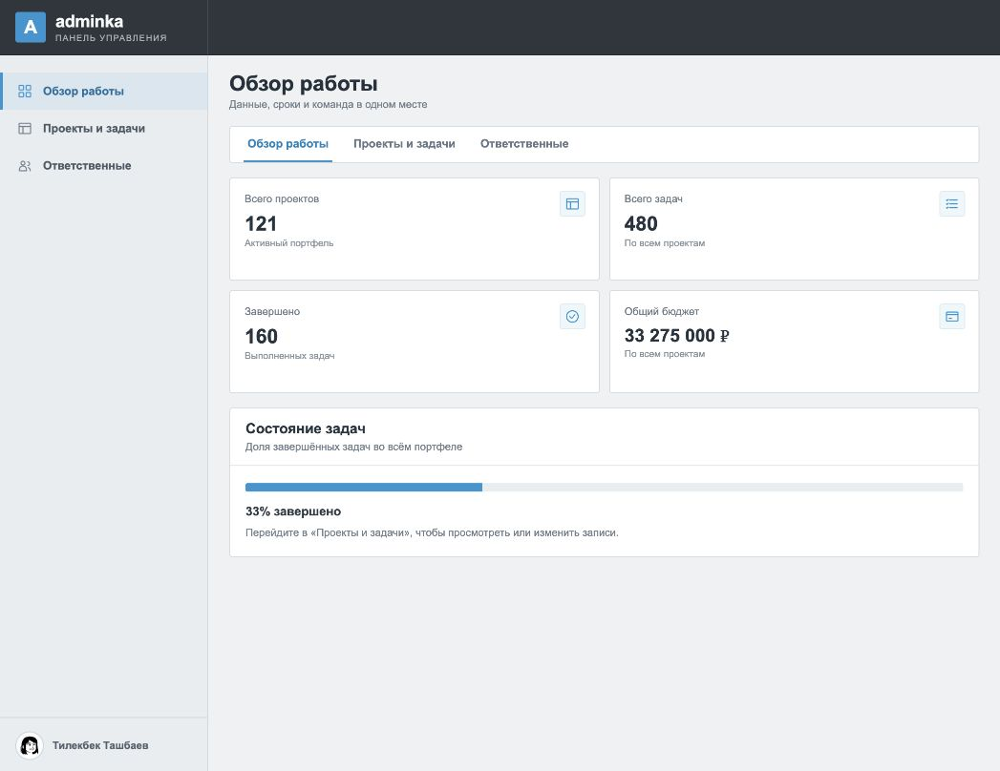
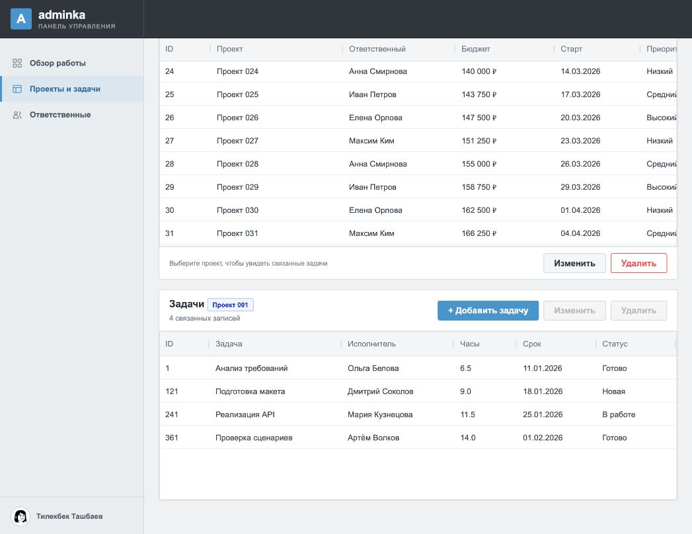
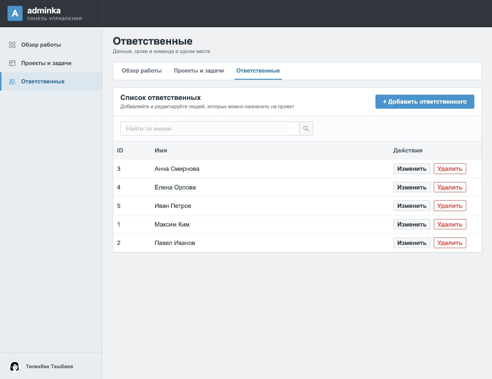

# Тестовое задание Fullstack

## Задача

Создать работоспособное веб-приложение: PostgreSQL с двумя связанными таблицами, REST API для CRUD и React Dashboard с двумя таблицами AG Grid. Главная таблица должна загружать строки частями через AG Grid Infinite Row Model; на сервере для этого нужны SQL `LIMIT` и `OFFSET`. Для связанной таблицы нужны работающие действия добавления, изменения и удаления с корректным внешним ключом. Дополнительно по запросу добавлено управление ответственными как отдельной сущностью.

## Выбранный стек

- Клиент: React + TypeScript, AG Grid, Ant Design, Vite.
- Сервер: Node.js + TypeScript + Express, разделение на `models`, `controllers`, `routes`.
- База данных: PostgreSQL, доступ через `pg-promise` и параметризованные SQL-запросы.
- Запуск базы: Docker Compose. Елизавета разрешила Express и Docker. SQL-файл создаёт базу, таблицы и демонстрационные записи при первом запуске контейнера.

## Структура проекта

```text
fullstack/
├── Readme.md
├── docker-compose.yml
├── init-db.sql             # создание и заполнение БД
├── client/                 # React Dashboard
│   └── src/
│       ├── index.jsx       # единственный файл в корне src
│       ├── style/          # переменные, общие и адаптивные SCSS-стили
│       ├── components/     # каждый компонент в своей папке: app/, dashboardLayout/,
│       │   │               # portfolioStats/, projectFilterBar/, диалоги и иконки
│       │   └── pages/      # index.js и папки overviewPage/, projectsPage/,
│       │                   # responsiblesPage/ с TSX и SCSS внутри
│       ├── hooks/          # состояние Dashboard и обработчики действий
│       ├── services/       # API, IndexedDB и сохранение фильтров
│       ├── models/         # типы данных и запросов
│       ├── config/         # фильтры и колонки таблиц
│       ├── providers/      # уведомления Ant Design
│       └── utils/          # форматирование дат, сумм и ошибок
└── server/
    ├── models/             # SQL и работа с данными
    ├── controllers/        # проверки и обработка запросов
    └── routes/             # REST-маршруты
```

В таблицах `projects` и `tasks` есть ключи и поля типов `NUMERIC`, `VARCHAR`, `DATE`, `INTEGER`. Связь реализована через `tasks.project_id → projects.id`. Дополнительная таблица `responsibles` хранит ответственных; проекты связаны с ней внешним ключом. Скрипт `init-db.sql` создаёт базу `test_dashboard`, структуру и 120 проектов с четырьмя задачами для каждого. Удаление проекта удаляет его задачи через `ON DELETE CASCADE`.

## Что должно работать

1. CRUD для сущностей через REST API.
2. Dashboard с боковым меню: стартовый раздел «Обзор работы», в разделе «Проекты и задачи» — две таблицы AG Grid.
3. Частичная загрузка главной таблицы: запрос диапазона строк на клиенте и `LIMIT/OFFSET` на сервере.
4. Добавление, изменение и удаление строк связанной таблицы с сохранением корректного внешнего ключа.
5. Обработка ошибок и понятные ответы API.
6. Создание, переименование и удаление ответственных в отдельном разделе. Проект выбирает ответственного из списка. Удалить назначенного на проект ответственного нельзя.

Успешные операции записи и ошибки сопровождаются уведомлениями. Клиент хранит GET-ответы в памяти вкладки и объединяет одновременные одинаковые запросы. Страницы проектов дополнительно сохраняются в IndexedDB (до 100 блоков): при повторном открытии они показываются сразу и проверяются на сервере в фоне. После успешного изменения данных оба кэша очищаются, а остальные открытые вкладки получают сигнал обновления. Кнопка «Обновить», возвращение на вкладку и восстановление сети сначала обращаются к серверу; если он недоступен, сохранённые страницы остаются видны с предупреждением.

## Запуск

Нужны Node.js 20.19+, npm и Docker с Compose. Ниже команды для трёх терминалов. Во всех примерах исходная папка — `fullstack/`.

Если папка `fullstack/` опубликована как отдельный Git-репозиторий, сначала выполните в ней `npm ci`: это установит Husky с проверкой `client/` и `server/` перед push. Для самого приложения также нужны зависимости в каждой из этих папок, как указано ниже.

Hook запускает форматирование и ESLint в обоих пакетах. Если Prettier изменит отслеживаемые файлы, push остановится до нового коммита.

**Терминал 1 — PostgreSQL:**

```bash
docker compose up -d
docker compose ps
```

Дождитесь статуса `healthy` у сервиса `db`. При первом запуске контейнер выполняет `init-db.sql` и создаёт демонстрационные записи.

**Терминал 2 — API:**

```bash
cp .env.example server/.env
cd server
npm ci
npm run dev
```

**Терминал 3 — React-клиент:**

```bash
cd client
npm ci
npm run dev
```

Откройте `http://localhost:5173`. Проверка API: `http://localhost:4000/api/health` должен вернуть `{"ok":true}`. Если порт `5173` занят, используйте адрес, который Vite покажет в терминале. Если порт PostgreSQL `5432` занят, измените проброс порта в `docker-compose.yml` и порт в `server/.env`.

Для остановки базы из папки `fullstack/` выполните `docker compose down`. Данные сохраняются в томе `postgres_data`.

Docker запускает `init-db.sql` только при первом создании тома. Если используете PostgreSQL без Docker, выполните `psql -U postgres -d postgres -v ON_ERROR_STOP=1 -f init-db.sql` под ролью с правом создания БД, затем укажите фактическую строку подключения в `server/.env`. Скрипт рассчитан на пустую базу.

Если база создана до появления раздела ответственных, один раз выполните миграцию перед запуском сервера:

```bash
docker compose exec -T db psql -U test_user -d test_dashboard -v ON_ERROR_STOP=1 < server/migrations/001_responsibles.sql
```

Миграция переносит существующие имена из проектов в таблицу ответственных, сохраняя проекты и задачи. Повторный запуск допустим.

Проверки из папок `server/` и `client/`:

```bash
npm run lint
npm run format:check
npm run build
```

В `server/` дополнительно выполните `npm test`. Для интеграционной проверки CRUD на запущенном API выполните из `server/`: `TEST_API_URL=http://localhost:4000 npm run test:api`. Тест создаёт временные записи и удаляет их после проверки. Команда `npm run format` форматирует исходники с двухпробельным отступом, шириной строки 90 символов и отдельной строкой для каждого JSX-атрибута.

## Скриншоты

Снимки сделаны после локальной проверки CRUD, поэтому количество проектов и список ответственных отличаются от исходного набора при первом запуске.








## API

| Метод | Маршрут | Действие |
| --- | --- | --- |
| GET | `/api/projects?offset=0&limit=20&search=` | Страница проектов и общее количество |
| GET, POST | `/api/responsibles` | Список и создание ответственных |
| PUT, DELETE | `/api/responsibles/:id` | Переименование и удаление ответственного |
| POST | `/api/projects` | Создание проекта |
| GET | `/api/projects/:id` | Карточка проекта |
| PUT, DELETE | `/api/projects/:id` | Изменение, удаление |
| GET, POST | `/api/projects/:projectId/tasks` | Список и создание задач проекта |
| PUT, DELETE | `/api/projects/:projectId/tasks/:id` | Изменение, удаление задачи |
| GET | `/api/overview` | Показатели Dashboard |

Ограничение `limit` — от 1 до 100. Ввод проверяется на сервере, значения SQL передаются параметрами.

## Перед сдачей

Проверить запуск с чистой БД, работу CRUD, частичную загрузку строк и связь таблиц. В GitHub-репозиторий должны попасть `client/`, `server/`, `init-db.sql` и этот README; `node_modules` публиковать не нужно.
